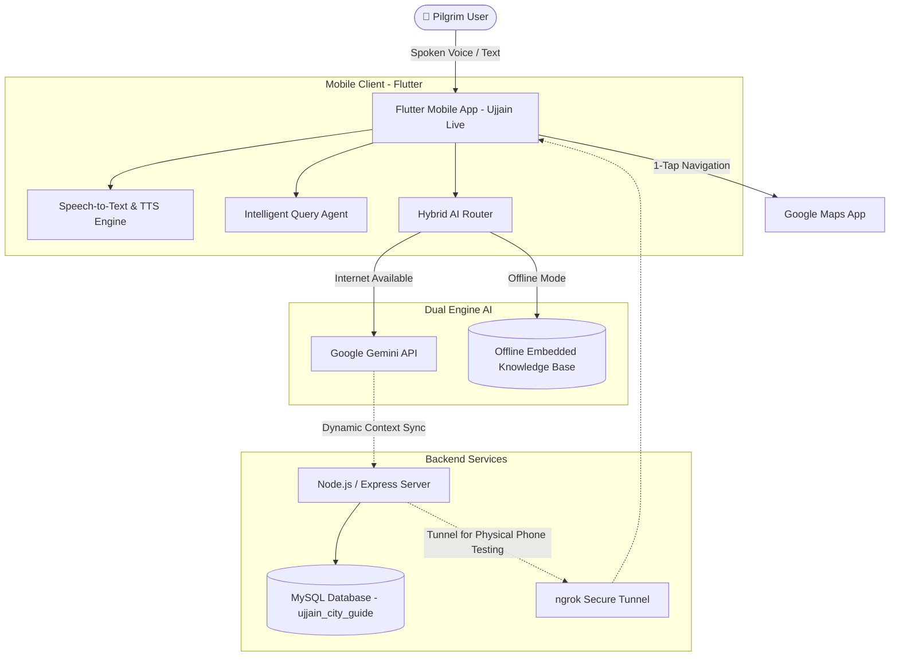

# 🕉️ Ujjain Live - Simhastha 2028 AI Assistant

<p align="center">
  <b>॥ हर हर महादेव • जय श्री महाकाल ॥</b><br>
  <i>Your Intelligent Digital Pilgrim Companion to Sacred Ujjain & Simhastha Mahakumbh 2028</i>
</p>

<p align="center">
  
  
  
  
  
  
</p>

---

## 📱 App Showcase

<div align="center">
  <table>
    <tr>
      <td align="center" width="33%">
        <b>🌟 Divine Splash & Identity</b><br>
        <sub>Sacred Kalash emblem & Simhastha 2028 hub</sub><br><br>
        
      </td>
      <td align="center" width="33%">
        <b>🏛️ Pilgrimage Guide & Prompts</b><br>
        <sub>Curated Darshan, Bhasma Aarti & Shahi Snan</sub><br><br>
        
      </td>
      <td align="center" width="33%">
        <b>💬 AI Voice Chat & Live Maps</b><br>
        <sub>Direct answers, Auto-Listen & Dynamic Google Maps</sub><br><br>
        
      </td>
    </tr>
  </table>
</div>

---

## 🌟 Key Highlights & Features

### ⚡ 1. Dual AI Engine (Online & Offline)
- **Online Mode (Google Gemini)**: Powered by Google Gemini (`gemini-3.5-flash-lite` / `gemini-3.8-flash`) delivering ultra-fast, direct, and concise spiritual answers. Dynamically augmented with verified knowledge from the MySQL database (`ujjain_city_guide`).
- **Offline Darshan Mode**: When internet connectivity drops in crowded temple corridors or ghats, the app seamlessly switches to an embedded offline knowledge base with 18+ temples, timings, and local data.

### 🗣️ 2. Intelligent Voice & Auto-Listen (Speech-to-Text & Text-to-Speech)
- **Continuous Voice Input**: Speak your pilgrimage questions naturally in Hindi or English using advanced Speech-to-Text.
- **Auto-Listen to Responses**: As soon as the AI response arrives, the app automatically reads the answer aloud via Text-to-Speech (TTS).
- **Clean Audio Processing**: Strips raw URLs and technical markdown symbols before speaking so the voice audio sounds natural and clean.
- **Instant Controls**: Toggle Auto-Listen on/off directly from the top AppBar (`[🔊 Listen ON]` / `[🔇 Listen OFF]`) or stop playback anytime with the `[■ Stop]` button on the message bubble.

### 🗺️ 3. Accurate Dynamic Google Maps Navigation
- **No Coordinate Drift**: Eliminates inaccurate static lat/long coordinates that often drop pins on open roads.
- **Verified Place Queries**: The AI dynamically formats clickable Google Maps links using official place name queries:
  - **Accommodations & Temples**: `https://www.google.com/maps/search/?api=1&query={Place+Name}+Ujjain`
  - **Turn-by-Turn Navigation**: `https://www.google.com/maps/dir/?api=1&destination={Destination}+Ujjain`
- One-tap opens the verified Google Business profile with official entrance gates, photos, live reviews, and direct routing.

### 🛕 4. Comprehensive Sacred Knowledge
- **Mahakaleshwar Jyotirlinga**: Bhasma Aarti booking rules, online slot guidelines, entry gates, and darshan timings.
- **Simhastha 2028 Kumbh Mela**: Shahi Snan auspicious dates, Ram Ghat & Triveni Ghat details, Akhara traditions.
- **18+ Sacred Temples**: Kal Bhairav, Harsiddhi Mata (Shaktipeeth), Chintaman Ganesh, Gadkalika, Sandipani Ashram, Mangalnath, and more.
- **Pilgrim Amenities**: Verified hotels, Dharamshalas, Ashrams, Sattvic pure vegetarian dining, and temple Annakshetra information.

---

## 🏗️ System Architecture



---

## 📂 Project Structure

```text
AI app/
├── readmeasset/                    # Screenshots showcased in README
│   ├── Image (3).jpg              # Divine Splash Screen
│   ├── Image (4).jpg              # Pilgrimage Guide & Prompts
│   └── Image (5).jpg              # Live AI Chat & Google Maps
│
├── ai_assistant/                   # Flutter Mobile Application
│   ├── assets/                     # App icons, logos, and local assets
│   ├── lib/
│   │   ├── agents/                 # Ujjain Guide Agent & system prompts
│   │   ├── constants/              # App colors, themes, API keys, URLs
│   │   ├── models/                 # Chat session, message & location models
│   │   ├── providers/              # State management (Chat, Speech)
│   │   ├── screens/                # Chat, City Guide, Map, Settings screens
│   │   ├── services/               # Gemini AI, Offline AI, Speech, Location
│   │   └── widgets/                # Message bubbles, chat inputs, map widgets
│   ├── build_apk_now.bat           # 1-Click release APK builder
│   └── build_for_phone.bat         # Interactive APK builder for physical phones
│
├── backend/                        # Node.js + Express Backend Server
│   ├── server.js                   # REST API server & database connector
│   ├── sync_db_context.js          # Synchronizes ujjain_city_guide with MySQL
│   ├── start_ngrok.bat             # 1-Click backend + ngrok tunnel launcher
│   └── test_api.bat                # Endpoint testing script
│
├── README.md                       # Main Project Documentation
└── README_PHONE_TESTING.md         # Dedicated physical phone testing guide
```

---

## 🚀 Getting Started

### Prerequisites
- **Flutter SDK**: `>= 3.10.0` ([Install Flutter](https://docs.flutter.dev/get-started/install))
- **Node.js**: `>= 18.x` & npm ([Install Node.js](https://nodejs.org/))
- **MySQL Server**: Local or hosted MySQL database
- **Google Gemini API Key**: Free key from [Google AI Studio](https://aistudio.google.com/)

---

### Step 1: Set Up Backend Server

1. Navigate to the backend directory and install dependencies:
   ```bash
   cd "backend"
   npm install
   ```

2. Configure database credentials in `backend/server.js` or environment variables:
   ```javascript
   const dbConfig = {
     host: 'localhost',
     user: 'root',
     password: 'YOUR_MYSQL_PASSWORD',
     database: 'simhastha_guide'
   };
   ```

3. Synchronize knowledge context:
   ```bash
   node sync_db_context.js
   ```

4. Start backend with ngrok (for physical phone testing):
   ```bash
   start_ngrok.bat
   ```
   *Copy your generated ngrok HTTPS URL (e.g., `https://xxxx.ngrok-free.app`).*

---

### Step 2: Set Up & Run Flutter App

1. Navigate to the Flutter app directory:
   ```bash
   cd "ai_assistant"
   flutter pub get
   ```

2. Configure API Key & Backend URL in `lib/constants/app_constants.dart`:
   ```dart
   static const String openAiApiKey = 'YOUR_GEMINI_API_KEY';
   static const String backendBaseUrl = 'https://your-ngrok-url.ngrok-free.app';
   ```

3. Run on a connected device / emulator:
   ```bash
   flutter run
   ```

---

## 📦 Building Release APK

To generate a standalone release APK for testing on physical Android devices:

```bash
cd "ai_assistant"
.\build_apk_now.bat
```

Or via Flutter CLI:
```bash
flutter build apk --release
```

The compiled APK will be generated at:
```text
ai_assistant/build/app/outputs/flutter-apk/app-release.apk
```

---

## 🧪 Testing on Physical Phones

For full physical phone testing workflows (via ngrok, local Wi-Fi, or ADB), refer to our detailed guides:
- 📖 **[README_PHONE_TESTING.md](README_PHONE_TESTING.md)**: Physical phone testing overview
- ⚡ **[QUICK_NGROK_REFERENCE.md](QUICK_NGROK_REFERENCE.md)**: Quick command cheatsheet
- 📋 **[TESTING_CHECKLIST.md](TESTING_CHECKLIST.md)**: Pre-deployment verification checklist

---

## 📜 Sacred Dedication

<p align="center">
  <b>॥ अवन्तिकायां विहितावतारं मुक्तिप्रदानाय च सज्जनानाम् ।<br>
  अकालमृत्योः परिरक्षणार्थं वन्दे महाकालमहासुरेशम् ॥</b><br><br>
  <i>Dedicated to the millions of pilgrims visiting the holy city of Ujjain and the upcoming Simhastha Kumbh Mela 2028.</i>
</p>
